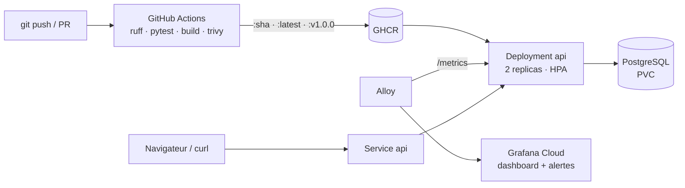

# Mise en production d'une API de sentiment

API FastAPI d'analyse de sentiment (avis de films en français) conteneurisée, testée et
publiée par GitHub Actions, déployée sur Kubernetes et supervisée dans Grafana Cloud.

**Dépôt :** <https://github.com/adel-855/cloud-sentiment-mini-project>

```
« Un film magnifique, je le recommande ! »  →  {"label": "positif", "confidence": 0.97, "model_version": "v1"}
```



| Dossier | Contenu |
|---|---|
| `app/` | code de l'API (fourni, non modifié) |
| `models/` | modèles v1 (89,5 %) et v2 (94,3 %) |
| `tests/` | tests pytest |
| `Dockerfile`, `compose.yaml` | étape 1 — conteneurisation |
| `.github/workflows/ci.yml` | étape 2 — lint, tests, image, scan Trivy, push GHCR |
| `k8s/` | étape 3 — Deployment, Service, ConfigMap, Secret, PostgreSQL + PVC, HPA, PDB |
| `observability/` | étape 4 — agent Alloy, dashboard JSON, règles d'alerte |
| `docs/ARCHITECTURE.md` | étape 5 — note d'architecture (cible cloud + coûts) |
| `docs/RAPPORT.md` | plan du rapport à rendre, avec les preuves à capturer |
| `.vscode/` | extensions recommandées, debug, tâches |

---

## 1. Prérequis

| Outil | Version testée | Vérifier |
|---|---|---|
| Docker + Docker Desktop (Kubernetes activé) | 29.x | `docker version`, `kubectl config get-contexts` |
| Python | 3.12 | `python3 --version` |
| Git / GitHub CLI | — | `git --version`, `gh auth status` |
| Compte Grafana Cloud | offre gratuite, région UE | — |

Activer Kubernetes : Docker Desktop → **Settings › Kubernetes › Enable Kubernetes**, puis
`kubectl config use-context docker-desktop`.

## 2. Démarrage rapide (from scratch)

```bash
git clone https://github.com/adel-855/cloud-sentiment-mini-project.git
cd cloud-sentiment-mini-project

# Développement local (optionnel)
python3 -m venv .venv && source .venv/bin/activate
pip install -r requirements-dev.txt
ruff check . && ruff format --check . && pytest -q
uvicorn app.main:app --reload            # http://localhost:8000

# Étape 1 : conteneurs + base
cp .env.example .env
docker compose up --build -d
curl -s localhost:8000/health

# Étape 3 : Kubernetes
cp k8s/.env.example k8s/.env             # éditer les identifiants
kubectl apply -k k8s/
kubectl -n sentiment get pods -w
curl -s localhost/health                 # Service LoadBalancer sur le port 80
```

Le reste (`make help`) :

```bash
make venv test lint build compose-up compose-down k8s-up k8s-status fault-latency fault-errors fault-off
```

---

## 3. Étape 1 — Conteneurisation

- Build **multi-stage** : `python:3.12` pour installer, `python:3.12-slim` pour exécuter.
- Image finale : **647 Mo** (< 800 Mo exigés) — `docker images sentiment-api:local`.
- Exécution **non-root** (`uid=10001`), `HEALTHCHECK` sur `/health/live`.
- `compose.yaml` : API + PostgreSQL 16, volume `pgdata`, `healthcheck`, `depends_on: service_healthy`.

```bash
docker build -t sentiment-api:local .
docker compose up --build -d
curl -X POST localhost:8000/predict -H 'Content-Type: application/json' \
  -d '{"text": "Un film magnifique, je le recommande !"}'
docker compose exec api id              # uid=10001(app) gid=10001(app)
```

Changer de modèle sans reconstruire : `MODEL_VERSION=v2 docker compose up -d api`.

## 4. Étape 2 — CI/CD (GitHub Actions)

`.github/workflows/ci.yml`, déclenché sur chaque push et pull request vers `main` :

| Job | Contenu |
|---|---|
| `lint` | `ruff check .` + `ruff format --check .` |
| `test` | `pytest -q` (Python 3.12) |
| `docker` | build BuildKit (cache `gha`), push **GHCR**, tags `sha` + `semver` + `latest`, scan **Trivy** bloquant sur `CRITICAL` |

Sur une PR : build sans push (validation du Dockerfile). Sur `main` : image poussée dans
`ghcr.io/adel-855/cloud-sentiment-mini-project`.

**Première image :** le package GHCR est privé par défaut. Le rendre public une fois :
GitHub → *Packages* → package → **Package settings › Change visibility › Public**.
Sinon, créer un secret de pull (voir Dépannage).

**Protéger `main`** (Settings › Branches › Add branch protection rule) :

- *Require a pull request before merging*
- *Require status checks to pass* → `Lint (ruff)`, `Tests (pytest)`
- *Do not allow bypassing the above settings*

Publier une version : `git tag v1.0.0 && git push origin v1.0.0` → image taguée `1.0.0`.

## 5. Étape 3 — Kubernetes

```bash
cp k8s/.env.example k8s/.env    # identifiants PostgreSQL (fichier ignoré par Git)
kubectl apply -k k8s/           # kustomize génère le Secret depuis k8s/.env
kubectl -n sentiment get deploy,pods,svc,hpa,pvc
```

| Objet | Rôle |
|---|---|
| `Deployment/api` | 2 replicas, `maxUnavailable: 0`, probes, requests/limits, conteneur durci |
| `Service/api` | `LoadBalancer` port 80 → 8000 (`http://localhost` sur Docker Desktop) |
| `ConfigMap/api-config` | `MODEL_VERSION`, `MODELS_DIR`, `FAULT_ERROR_RATE`, `FAULT_LATENCY_MS` |
| `Secret/postgres-credentials` | généré depuis `k8s/.env`, jamais versionné |
| `Deployment/db` + `PVC/postgres-data` | PostgreSQL 16, volume 1 Gi, stratégie `Recreate` |
| `HPA/api` | 2 → 5 pods à 60 % CPU |
| `PDB/api` | `minAvailable: 1` |

**Probes — le choix expliqué :** *readiness* sur `/health` car un pod qui ne joint pas la
base ne doit pas recevoir de trafic ; *liveness* sur `/health/live` car une base
indisponible ne doit pas faire redémarrer l'application en boucle (cela ne ferait
qu'aggraver la panne). Le `startupProbe` couvre le chargement du modèle.

Vérifier la continuité de service :

```bash
while true; do curl -s -o /dev/null -w '%{http_code}\n' localhost/health; sleep 0.3; done &
kubectl -n sentiment delete pod -l app.kubernetes.io/name=api
# que des 200 : le second pod répond pendant le redémarrage
```

Déployer une nouvelle image : `kubectl -n sentiment set image deploy/api api=<image>:<sha>`.
Rollback : `kubectl -n sentiment rollout undo deploy/api`.

## 6. Étape 4 — Observabilité (Grafana Cloud + Alloy)

1. Créer un compte Grafana Cloud (région UE) et une instance **Prometheus**.
2. Récupérer l'URL *remote_write*, l'utilisateur (instance ID) et créer un token avec le
   droit `metrics:write`.
3. Créer le Secret dans le cluster (jamais dans Git) :

   ```bash
   kubectl -n sentiment create secret generic grafana-cloud \
     --from-literal=GRAFANA_REMOTE_WRITE_URL='https://prometheus-prod-XX-XXXX.grafana.net/api/prom/push' \
     --from-literal=GRAFANA_USERNAME='123456' \
     --from-literal=GRAFANA_TOKEN='glc_...'
   ```

4. Déployer l'agent :

   ```bash
   kubectl apply -f observability/alloy.yaml
   kubectl -n sentiment logs deploy/alloy --tail=50
   ```

   `config.alloy` découvre les pods `app.kubernetes.io/name=api`, scrape `/metrics`
   toutes les 15 s, scrape le kubelet (cAdvisor) pour le CPU/RAM des conteneurs, et fait
   un `remote_write` vers Grafana Cloud.

5. Importer `observability/dashboard.json` (Dashboards › New › Import) puis choisir le
   datasource Prometheus. Le dashboard couvre les 3 niveaux :
   **Technique** (p95, erreurs, disponibilité, pods prêts, CPU, RAM),
   **ML** (confiance moyenne, versions, distribution),
   **Métier** (prédictions/s, part d'avis positifs, trafic par code HTTP).
6. Créer les alertes de `observability/alerts.yaml` (Alerting › Alert rules), en adaptant
   `datasourceUid` : p95 > 500 ms (5 min), erreurs 5xx > 5 % (5 min), disponibilité < 99 %
   sur 1 h.

**Déclencher une alerte :**

```bash
make fault-latency     # FAULT_LATENCY_MS=800
make fault-errors      # FAULT_ERROR_RATE=0.3
make fault-off
kubectl -n sentiment get hpa -w        # observer l'autoscaling pendant la charge
```

## 7. Étape 5 — Note d'architecture

[`docs/ARCHITECTURE.md`](docs/ARCHITECTURE.md) : schéma, cible **GKE Autopilot**
(`europe-west1`), estimation **~82 $/mois** détaillée, alternatives (AKS, EKS, Cloud Run),
limites et feuille de route. Le plan du rapport avec les preuves à capturer est dans
[`docs/RAPPORT.md`](docs/RAPPORT.md).

## 8. Configuration de l'application

| Variable | Défaut | Rôle |
|---|---|---|
| `MODEL_VERSION` | `v1` | modèle chargé (`v1` ou `v2`) |
| `MODELS_DIR` | `models` | dossier des modèles |
| `DATABASE_URL` | `sqlite:///./predictions.db` | base ; PostgreSQL en production |
| `FAULT_ERROR_RATE` | `0` | part de prédictions en erreur (0.3 = 30 %) |
| `FAULT_LATENCY_MS` | `0` | latence artificielle par prédiction |

| Route | Rôle |
|---|---|
| `POST /predict` | `{"text": "..."}` → label, confiance, version |
| `GET /history?limit=10` | dernières prédictions |
| `GET /health` | 200 si API **et** base OK, 503 sinon |
| `GET /health/live` | 200 tant que le processus tourne |
| `GET /metrics` | métriques Prometheus |
| `GET /` | page web de test |

## 9. VS Code

Les extensions sont déclarées dans `.vscode/extensions.json` (VS Code les propose à
l'ouverture du dossier). Installation en ligne de commande :

```bash
code --install-extension ms-python.python ms-python.vscode-pylance charliermarsh.ruff \
  ms-python.debugpy ms-azuretools.vscode-docker ms-kubernetes-tools.vscode-kubernetes-tools \
  redhat.vscode-yaml github.vscode-github-actions github.vscode-pull-request-github \
  eamodio.gitlens humao.rest-client bierner.markdown-mermaid timonwong.shellcheck
```

| Extension | Usage ici |
|---|---|
| Python + Pylance + debugpy | autocomplétion, debug de `uvicorn` (`F5`) |
| Ruff | lint + format à la sauvegarde, mêmes règles que la CI |
| Docker | construire/voir les conteneurs, `compose.yaml` |
| Kubernetes | explorer les pods, logs, `k8s/*.yaml` |
| YAML (Red Hat) | validation des manifests et des workflows |
| GitHub Actions / Pull Requests | suivre les runs et les PR |
| GitLens | historique et blame |
| REST Client | `api.http` : toutes les routes en un clic |
| Markdown Mermaid | aperçu des schémas du README |

Tâches prêtes à l'emploi : `Ctrl+Shift+P` → *Tasks: Run Task* → `Lint`, `Tests`,
`Docker: up`, `K8s: apply`, `K8s: port-forward`.

## 10. Dépannage

| Symptôme | Cause / solution |
|---|---|
| `ImagePullBackOff` | package GHCR privé → le rendre public, ou `kubectl -n sentiment create secret docker-registry ghcr-pull --docker-server=ghcr.io --docker-username=<user> --docker-password=<PAT>` puis ajouter `imagePullSecrets` au Deployment |
| Pods API en `CrashLoopBackOff` | `kubectl -n sentiment logs deploy/api` ; souvent `DATABASE_URL` absent ou base pas prête |
| `/health` renvoie 503 | PostgreSQL injoignable : `kubectl -n sentiment logs deploy/db`, vérifier le Secret |
| `kubectl apply -k` : `evalsymlink failure … k8s/.env` | copier `k8s/.env.example` en `k8s/.env` |
| Pas d'IP externe sur le Service | Docker Desktop : `localhost` ; sinon `kubectl port-forward svc/api 8000:80` |
| HPA affiche `<unknown>` | metrics-server absent (inclus dans Docker Desktop) ; `kubectl top pods -n sentiment` |
| Alloy en erreur d'authentification | vérifier le token Grafana (`metrics:write`) et l'URL `remote_write` |
| Rien dans Grafana | métriques visibles après ~1 min ; vérifier `kubectl -n sentiment logs deploy/alloy` |
| `ModuleNotFoundError: app` | se placer à la racine du dépôt |

## 11. Livrables

- [x] Dépôt public avec Dockerfile, compose, pipeline, manifests, observabilité
- [x] README de reproduction complète
- [ ] Rapport PDF (`docs/RAPPORT.md` complété + captures)
- [ ] Dépôt et rapport envoyés à `Alexis.Bouchendhomme@uphf.fr`
