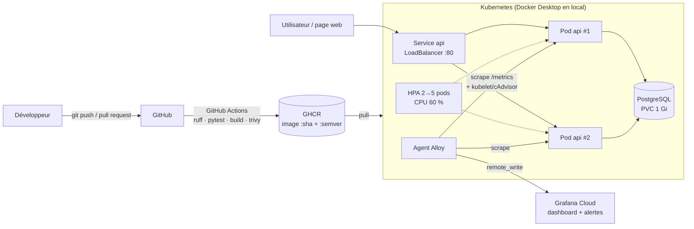

# Note d'architecture — API de sentiment en production

> Étape 5 du mini-projet. Cible : une API FastAPI + PostgreSQL, livrée par GitHub Actions,
> exécutée sur Kubernetes et supervisée par Grafana Cloud.

## 1. Architecture mise en place

En local : `docker compose up` (étape 1), puis `kubectl apply -k k8s/` (étape 3), puis
l'agent Alloy envoie les métriques à Grafana Cloud (étape 4).

## 2. Cible en production : GKE Autopilot (recommandé)

| Critère | GKE Autopilot | AKS (Free tier) | EKS | Cloud Run |
|---|---|---|---|---|
| Gestion du cluster | Google gère les nœuds | Nœuds à gérer | Nœuds à gérer | Aucun cluster |
| Réutilise nos manifests | Oui | Oui | Oui | Non (nouveau déploiement) |
| Coût plancher | ~40 $/mois | ~35 $/mois | ~90 $/mois | ~0 $ |
| Effort d'exploitation | Faible | Moyen | Élevé | Très faible |
| Région UE / RGPD | `europe-west1` | `francecentral` | `eu-west-3` | `europe-west1` |

**Choix : GKE Autopilot, région `europe-west1` (Belgique).** Le projet est déjà écrit pour
Kubernetes : on réutilise les mêmes manifests sans réécriture. Autopilot facture au pod
(pas de nœuds à dimensionner), applique les mises à jour de sécurité et reste dans l'UE,
ce qui simplifie la conformité RGPD. AKS serait équivalent si le groupe dispose de crédits
Azure ; EKS est plus cher et plus opérationnel ; Cloud Run est le moins cher mais abandonne
Kubernetes, donc l'essentiel du travail des étapes 1 à 4.

### Alternatives écartées

- **PaaS (Render, Fly.io, Scalingo)** : très simple, mais ne valorise pas le travail
  Kubernetes et limite le contrôle (HPA, PDB, probes).
- **Serverless (Cloud Run)** : excellent pour un trafic irrégulier, mais impose de repenser
  le déploiement (aucun manifest) et de déporter la base vers un service managé.

## 3. Estimation de coût mensuel (GKE Autopilot)

Hypothèses : 730 h/mois, 2 pods API (0,5 vCPU / 1 GiB chacun), 1 pod PostgreSQL
(0,5 vCPU / 1 GiB, PVC 10 GiB), tarifs publics UE approximatifs de 2026 — à revérifier
avec le calculateur GCP.

| Poste | Détail | Coût / mois |
|---|---|---|
| Pods API (Autopilot) | 1 vCPU + 2 GiB | ~40 $ |
| Pod PostgreSQL | 0,5 vCPU + 1 GiB | ~20 $ |
| Disque persistant | 10 GiB `pd-balanced` | ~2 $ |
| Load balancer | 1 LB régional | ~18 $ |
| Sortie réseau | ~20 GiB | ~2 $ |
| GHCR / GitHub Actions | dépôt public | 0 $ |
| Grafana Cloud | offre gratuite (10 k séries, 14 j) | 0 $ |
| **Total** | | **~82 $/mois** |

Variantes : **AKS** ~65 $/mois (1 nœud B2s + LB), **EKS** ~120 $/mois (contrôle à 73 $),
**Cloud Run + Neon** ~10–25 $/mois. Pour un vrai production, remplacer PostgreSQL dans le
cluster par **Cloud SQL** (haute disponibilité, sauvegardes) : +50 à 100 $/mois.

*Liens : [calculateur GCP](https://cloud.google.com/products/calculator), [tarifs GKE](https://cloud.google.com/kubernetes-engine/pricing).*

## 4. Limites de la solution actuelle

1. **Un seul nœud** sur Docker Desktop : la perte du nœud perd les deux replicas. En cloud,
   Autopilot place les pods sur des nœuds distincts (contrainte de spread déjà présente).
2. **PostgreSQL dans le cluster**, un seul replica, pas de sauvegarde : acceptable pour un
   TP, pas pour de la production.
3. **Pas de TLS ni de nom de domaine** : le Service est exposé en HTTP via LoadBalancer.
4. **Secrets dans des variables d'environnement** : visibles via `kubectl describe`. En
   production, utiliser External Secrets Operator + Secret Manager.
5. **Déploiement manuel** (`kubectl apply`) : pas de GitOps, donc dérive possible entre Git
   et le cluster.
6. **Observabilité limitée** : métriques seulement, pas de logs centralisés ni de traces ;
   rétention gratuite de 14 jours.
7. **Image non signée**, pas de SBOM ; Trivy ne bloque que sur les CVE `CRITICAL`.
8. **Modèle figé** : pas de ré-entraînement, pas de suivi de dérive (data drift).

## 5. Améliorations prioritaires

| Priorité | Action | Bénéfice |
|---|---|---|
| 1 | Terraform pour le cluster, le LB et Cloud SQL | infrastructure reproductible |
| 2 | Argo CD (GitOps) + Argo Rollouts (canary v1→v2) | déploiement progressif et rollback automatique |
| 3 | Cloud SQL + sauvegardes + PITR | durabilité des données |
| 4 | External Secrets + Secret Manager | plus aucun secret dans le cluster |
| 5 | ingress-nginx + cert-manager (Let's Encrypt) | HTTPS et nom de domaine |
| 6 | Loki (logs) + OpenTelemetry (traces) | diagnostic bout en bout |
| 7 | KEDA (autoscaling sur la file de requêtes) + SLO suivis | coût maîtrisé, fiabilité mesurée |
| 8 | Ré-entraînement planifié + détection de dérive | qualité du modèle dans le temps |
